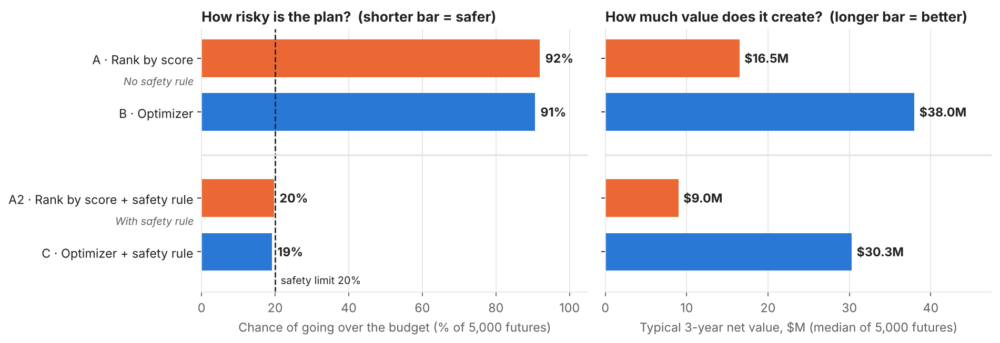
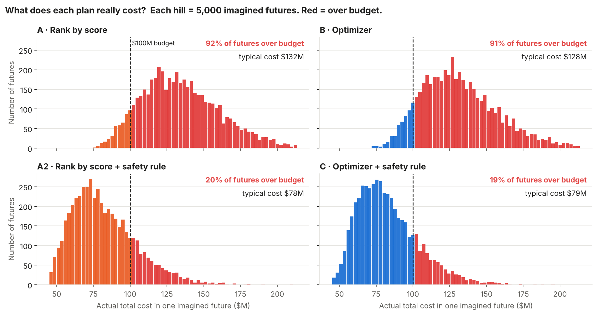
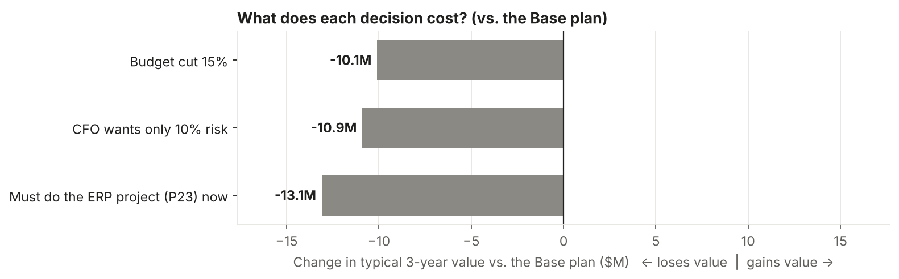
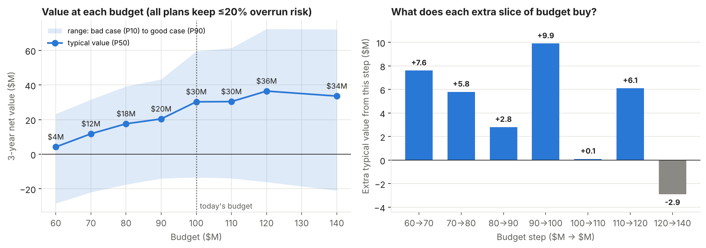
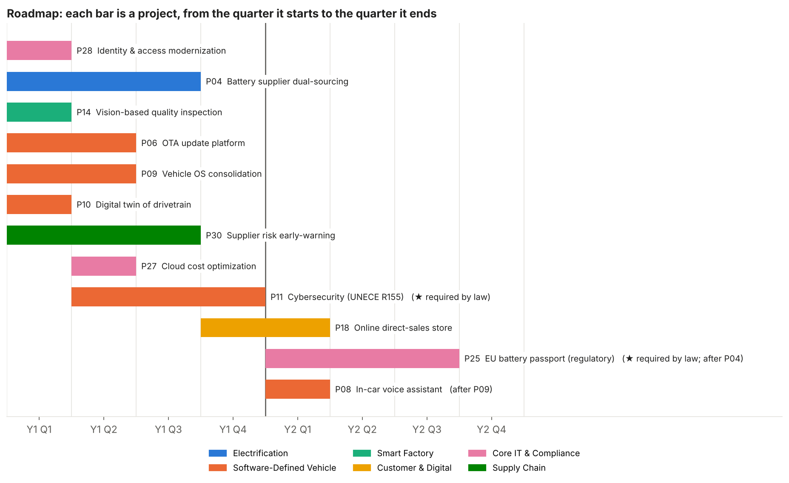

# Risk-Aware Portfolio Optimization

**Choosing which projects to fund, and when, when costs are uncertain.**
Monte Carlo simulation + integer optimization (Google OR-Tools) + an AI-agent interface (Model Context Protocol).



---

## The problem

*Nordhavn Motors* (a fictional global automaker) has **32 project requests worth $190M** and a **$100M budget** for the next two years. On top of that:

- its **teams are limited** (software, data/AI, mechanical engineering, project management)
- some projects **depend on others** (no predictive maintenance before the factory data lake exists)
- **two projects are required by law** (a cybersecurity regulation and the EU battery passport)
- project **cost estimates are usually too optimistic**: across 1,471 IT projects, the average cost overrun was 27%, and about 1 in 6 projects overran by roughly 200% (Flyvbjerg & Budzier, *Harvard Business Review*, 2011)

**The leadership question:** *Which projects should we fund, when should each one start, and how confident can we be that we'll stay within budget?*

## The approach

| Step | Question it answers | Technique |
|---|---|---|
| 1. Uncertainty model | How wrong are the estimates likely to be? | **Monte Carlo simulation**: 5,000 imagined futures per plan, calibrated to the research above (lognormal overruns, fat-tailed "black swans", and a shared shock so overruns are correlated) |
| 2. Common method (baseline) | What happens if we rank projects by strategic score? | **Greedy heuristic** |
| 3. Optimizer | What is the best combination of projects *and* start quarters? | **Integer programming** with Google OR-Tools **CP-SAT**: budget, quarterly team capacity, dependencies and legal requirements as constraints; maximize time-aware 3-year net value |
| 4. Safety rule | What's the best plan with at most a 20% chance of going over budget? | **Chance-constrained planning**: a bisection search on the planning budget, with each candidate plan tested by simulation |
| 5. What-ifs | What do budget cuts, risk appetite, political decisions and team changes cost? | **Scenario analysis** and **efficient frontier** |
| 6. AI interface | Can a manager ask these questions in plain English? | **MCP server**: the engine exposed as 5 tools any MCP-compatible AI assistant can call |

## Key results

Budget $100M, 5,000 simulated futures per plan.

| Plan | Projects | Chance of going over budget | Typical 3-year value |
|---|---|---|---|
| A · Rank by score (common method) | 16 | **92%** | $16.5M |
| B · Optimizer | 18 | 91% | $38.0M (**2.3×** A) |
| A2 · Rank by score + 20% safety rule | 6 | 20% | $9.0M |
| C · Optimizer + 20% safety rule | 12 | 19% | $30.3M (**3.4×** A2) |

1. **Plans built on estimates almost always overrun.** Filling the budget to 100% gives about a 92% chance of going over.
2. **Optimizing combinations and timing beats ranking by score.** At equal safety, the optimizer creates **3.4×** the typical value. Starting the most valuable project first, rather than in quarter 3, roughly doubles that project's value.
3. **Risk belongs at the portfolio level.** Padding every project to its 80th-percentile cost was infeasible and wasteful. The portfolio-level safety rule keeps about **$15M as a contingency reserve**.
4. **Every decision has a price tag.** A 15% budget cut costs about $10M of value; demanding 10% instead of 20% risk costs about $11M; forcing an ERP migration in costs about $13M.
5. **The data/AI team is the bottleneck.** Losing a quarter of it costs about $11M of value, while software engineers are not a constraint.
6. **Diminishing returns above about $120M.** Extra budget beyond that buys risk, not value.



*Each panel is a histogram of 5,000 simulated futures. Red bars are futures where the plan went over the $100M budget.*







## Project structure

```
├── Nordhavn_Portfolio_Optimization.ipynb   ← everything is here: data, simulation, optimization, charts, AI interface
├── data/                initiatives.csv, dependencies.csv, capacity.csv (created by the notebook)
├── images/              charts used in this README (created by the notebook)
├── portfolio_engine.py  auto-written by the notebook (Step 10) so the AI interface can use the engine
├── mcp_server.py        auto-written by the notebook (Step 10): the MCP server for AI assistants
└── requirements.txt
```

All the work happens in the notebook. The two `.py` files exist only because an MCP server has to run as a separate program; the notebook writes them for you.

## How to run

```bash
pip install -r requirements.txt
jupyter notebook Nordhavn_Portfolio_Optimization.ipynb
```

Then choose **Run → Run All Cells**. The notebook creates the data, runs the analysis, draws the charts, writes the MCP server, and tests it by acting like an AI app (Step 10).

To use the tools from a desktop AI app that supports MCP, add the server to the app's MCP configuration:

```json
{"mcpServers": {"portfolio": {"command": "python", "args": ["/full/path/to/mcp_server.py"]}}}
```

Then ask, for example: *"If our budget drops to $85M, what should we fund and how risky is it?"*

## MCP tools

| Tool | What it does |
|---|---|
| `list_initiatives` | List candidate projects, optionally filtered by theme |
| `project_risk` | Monte Carlo risk profile (typical and cautious cost and duration) of selected projects |
| `simulate_portfolio` | Stress-test any proposed plan in 5,000 futures |
| `optimize_portfolio` | Best plan for a budget, risk limit, team changes and must-include/exclude projects |
| `compare_scenarios` | Run several what-if scenarios side by side |

The AI assistant understands the question and explains the answer. Every number comes from the solver and the simulation, not from the language model.

## Limitations and next steps

- **Synthetic data.** Next: calibrate the risk model on real planned-vs-actual project history, for example the public project database of Batselier & Vanhoucke, or an organization's own records.
- **Resource contention.** Delays propagate through dependencies, but projects don't *queue* for shared teams. Next: a discrete-event simulation (e.g. SimPy).
- **Benefits are treated as known.** Next: a machine-learning model predicting delivery delays and benefits, with its uncertainty fed into the simulation.
- **Dependencies are a hand-made table.** In practice they would come from a knowledge graph linking goals, initiatives, tasks and people.
- **Search method.** The bisection keeps the plan from the largest passing planning budget. Keeping the most valuable passing plan, or using sample-average approximation or stochastic programming, would be more rigorous.

## References

- Flyvbjerg, B. & Budzier, A. (2011). *Why Your IT Project May Be Riskier Than You Think.* Harvard Business Review.
- Google OR-Tools, CP-SAT solver: https://developers.google.com/optimization
- Model Context Protocol: https://modelcontextprotocol.io
